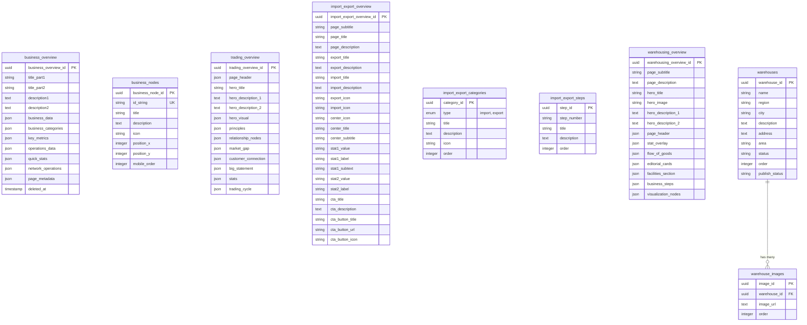
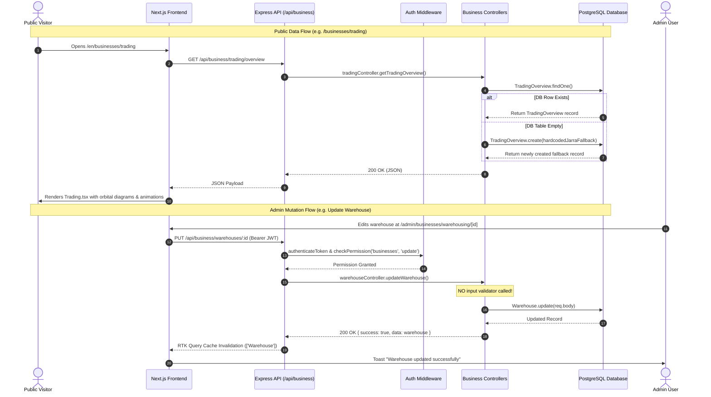

# MIDI Website — Business Section Discovery and Analysis (Read-Only Audit)

**Document Name:** `BUSINESS_SECTION_ANALYSIS.md`  
**Date:** October 18, 2026  
**Repository:** `C:\Users\Amanuel Daniel\Desktop\MoM\projects\midi-website-1`  
**Current Branch:** `component-update`  
**Remote:** `https://github.com/Minster-of-Mining-and-Minerals/midi-website.git`  
**Target Entity:** Mineral Industry Development Institute (MIDI), Ethiopia (Ministry of Mines)  
**Nature of Task:** Read-Only Audit & Architectural Analysis (No code modifications)

---

## 1. Executive Summary

This investigation provides a comprehensive, code-verified audit of the existing **Business section** within the MIDI website codebase. The application was originally developed for **Jarra Holding Group**, a diversified commercial conglomerate involved in agricultural commodity export, commercial trading, private warehousing, and logistics.

The current Business module was constructed to showcase Jarra's private corporate holding structure across four main commercial pillars:
1. **Overview & Business Nodes:** Corporate structure, key metrics, operations grid, and an interactive animated SVG node graph.
2. **Import & Export:** International trading operations, commodity categories, export workflows, and a mock licensing application timeline.
3. **Trading:** Commercial trading philosophy, market gap analysis, customer-supplier relationship nodes, and volume statistics ($5M+ export, $20M+ import).
4. **Warehousing:** Physical warehouse directory, regional facility showcase with image galleries, and supply chain logistics flow.

### Key Discoveries & Status Quo
- **Institutional Incompatibility:** The codebase contains deep commercial residue that directly contradicts MIDI's mandate as a federal regulatory, research, and technical development institute under the Ministry of Mines. Examples include references to *"500 MT of Coffee Volume"*, private commercial trading volumes (*"$5M+ Export Performance"*, *"$20M+ Annual Import Value"*), and generic corporate holding operations (*"Movement of Goods"*, *"Logistics Management"*).
- **Silent Database Mutation on GET Requests:** Several backend GET endpoints (`GET /api/business/overview`, `GET /api/business/trading/overview`, `GET /api/business/import-export/overview`, `GET /api/business/warehouses/overview`) violate the HTTP GET idempotency contract. When a database table is empty, the controller automatically executes `Model.create({...})` to inject hardcoded Jarra commercial fallback data directly into PostgreSQL upon a simple visitor query.
- **Frontend Blank/Empty-State Failures:** Critical frontend components (`OurBusinesses.tsx`, `ImportExport.tsx`, `WarehousingTrading.tsx`) have hardcoded conditional logic that returns `null` when underlying records or nodes are missing. In the current PostgreSQL database, `business_nodes`, `import_export_overview`, and `warehousing_overview` contain 0 rows, which causes the public pages at `/[locale]/businesses`, `/[locale]/businesses/import-export`, and `/[locale]/businesses/warehousing` to render blank or truncated layouts.
- **Unstructured JSON Storage Anti-Pattern:** The database schema for `business_overview`, `trading_overview`, and `warehousing_overview` relies almost entirely on unstructured JSON columns (`key_metrics`, `operations_data`, `principles`, `relationship_nodes`, `flow_of_goods`, `editorial_cards`, `page_metadata`). There are no relational constraints, indexing, or schema validation.
- **Zero Validation Middleware & Zero Tests:** Unlike other modules (such as Publications or News), none of the business endpoints in `backend/routers/business/businessRoutes.js` utilize Joi or express-validator schemas. Controllers accept arbitrary `req.body` payloads and execute unvalidated mass assignments directly into PostgreSQL. No unit, integration, or end-to-end tests exist for the business module.
- **Complete Lack of Localization (Amharic) in Data Models:** None of the business database tables support bilingual content. There are zero `_am` columns (such as `title_am` or `description_am`). All persisted content is strictly English-only, despite the portal supporting English (`/en`) and Amharic (`/am`).

---

## 2. Verified Repository and Technology Overview

| Layer | Technology | Version / Configuration | Verification Source |
| :--- | :--- | :--- | :--- |
| **Frontend Framework** | Next.js (App Router) | `16.0.8` (Webpack dev mode) | `frontend/package.json:44` |
| **Frontend UI Core** | React | `19.2.1` | `frontend/package.json:51` |
| **State Management** | Redux Toolkit & RTK Query | `@reduxjs/toolkit: 2.11.1`, `react-redux: 9.2.0` | `frontend/package.json:28,57` |
| **Styling & Animation** | Tailwind CSS & Framer Motion | `tailwindcss: 3.4.1`, `framer-motion: 12.29.2` | `frontend/package.json:41` |
| **Internationalization** | next-intl | `4.8.1` (Locales: `en`, `am`) | `frontend/package.json:46` |
| **Backend Runtime** | Node.js (CommonJS) | Express `5.1.0` | `backend/package.json:6,31` |
| **Database ORM** | Sequelize & Sequelize CLI | `sequelize: 6.37.7`, `sequelize-cli: 6.6.3` | `backend/package.json:47,56` |
| **Database Engine** | PostgreSQL | `pg: 8.16.3` (running on port 5432) | `backend/package.json:44` |
| **Reverse Proxy** | Nginx | Multi-stage Docker configuration | `nginx/nginx.conf` |

**Git Status Verification:**
- Working directory: `C:\Users\Amanuel Daniel\Desktop\MoM\projects\midi-website-1`
- Active Branch: `component-update` (tracking `origin/component-update`)
- Remote URL: `https://github.com/Minster-of-Mining-and-Minerals/midi-website.git`
- Working tree status: Clean (no uncommitted or unstaged changes)

---

## 3. Complete Route Inventory

### 3.1 Public Routes

| Route Pattern | Component File | Description & Behavior | Data Source |
| :--- | :--- | :--- | :--- |
| `/[locale]/businesses` | `frontend/src/app/[locale]/(public)/businesses/page.tsx` | Root business page. Renders `OurBusinesses.tsx` (ecosystem interactive diagram). Returns `null` if `business_nodes` is empty in DB. | `GET /api/business/overview`<br>`GET /api/business/nodes` |
| `/[locale]/businesses/overview` | `frontend/src/app/[locale]/(public)/businesses/overview/page.tsx` | Two-column operations dashboard: key metrics grid, general overview banner, operations table, key verticals, and network operations list. | `GET /api/business/overview`<br>`GET /api/attachments` |
| `/[locale]/businesses/trading` | `frontend/src/app/[locale]/(public)/businesses/trading/page.tsx` | Commercial trading philosophy: principles, animated orbital node network, market gap diagram, relationship SVG map, big statement, and volume stats. | `GET /api/business/trading/overview` |
| `/[locale]/businesses/import-export` | `frontend/src/app/[locale]/(public)/businesses/import-export/page.tsx` | Import/Export overview, trade category cards (import vs export), and trade facilitation step sequence. Returns `null` if DB overview is missing. | `GET /api/business/import-export/overview`<br>`GET /api/business/import-export/categories`<br>`GET /api/business/import-export/steps` |
| `/[locale]/businesses/import-export/[application_id]` | `frontend/src/app/[locale]/(public)/businesses/import-export/[application_id]/page.tsx` | Static application timeline, required documents list, and dummy buttons (*"Start New Application"*, *"Track Existing Application"*). Completely ignores `application_id`. | 100% hardcoded static UI (No API interaction) |
| `/[locale]/businesses/warehousing` | `frontend/src/app/[locale]/(public)/businesses/warehousing/page.tsx` | Composite facility page rendering `WarehousingTrading.tsx` (flow of goods) and `WarehouseShowcase.tsx` (searchable warehouse directory with image lightboxes). | `GET /api/business/warehouses/overview`<br>`GET /api/business/warehouses` |

### 3.2 Administrative Routes

| Route Pattern | Component File | Admin Capabilities | Required Permission |
| :--- | :--- | :--- | :--- |
| `/[locale]/admin/businesses` | `frontend/src/app/[locale]/(private)/admin/businesses/page.tsx` | Edit overview text (`title_part1/2`, `description1/2`) and manage 7 static coordinates of the interactive network diagram. | `BUSINESSES:READ`<br>`BUSINESSES:UPDATE` |
| `/[locale]/admin/businesses/overview` | `frontend/src/app/[locale]/(private)/admin/businesses/overview/page.tsx` | Complex multi-tab JSON editor: General Info, Key Metrics, Operations Table, Key Verticals, Network Operations, and Quick Stats. | `BUSINESSES:READ`<br>`BUSINESSES:UPDATE` |
| `/[locale]/admin/businesses/import-export` | `frontend/src/app/[locale]/(private)/admin/businesses/import-export/page.tsx` | Edit page titles/stats, manage Export categories, Import categories, and trade process steps (CRUD). | `BUSINESSES:READ`<br>`BUSINESSES:UPDATE` |
| `/[locale]/admin/businesses/trading` | `frontend/src/app/[locale]/(private)/admin/businesses/trading/page.tsx` | Edit principles, orbital visual titles, 5 relationship nodes, market gap labels, big statement, and 6 orbiting ecosystem words. | `BUSINESSES:READ`<br>`BUSINESSES:UPDATE` |
| `/[locale]/admin/businesses/warehousing` | `frontend/src/app/[locale]/(private)/admin/businesses/warehousing/page.tsx` | Multi-tab manager for warehouse hero banner, stats, flow of goods, and embedded warehouse listing table (`AdminWarehouseList.tsx`). | `BUSINESSES:READ`<br>`BUSINESSES:UPDATE` |
| `/[locale]/admin/businesses/warehousing/create` | `frontend/src/app/[locale]/(private)/admin/businesses/warehousing/create/page.tsx` | Create physical warehouse entry: name, region, city, address, area, status, and image uploads. | `BUSINESSES:CREATE` |
| `/[locale]/admin/businesses/warehousing/[id]` | `frontend/src/app/[locale]/(private)/admin/businesses/warehousing/[id]/page.tsx` | Edit warehouse metadata, toggle publish status (`published` vs `draft`), reorder images, or delete warehouse. | `BUSINESSES:UPDATE`<br>`BUSINESSES:DELETE` |

---

## 4. Frontend Component and Page Inventory

### 4.1 Page Components (`frontend/src/components/pages/businesses-page-components/`)

1. **`OurBusinesses.tsx` (291 lines):**
   - **Responsibility:** Interactive holding-company ecosystem visualizer.
   - **Visual Elements:** Central rotating circle ("MIDI ETHIOPIA"), SVG dashed lines to 6 peripheral nodes, Framer Motion hover states, coordinate transforms.
   - **Failure Point:** Line 91: `if (!overview || businessNodes.length === 0) return null;`. Since `business_nodes` is empty in DB, this component renders nothing.
2. **`Trading.tsx` (345 lines):**
   - **Responsibility:** Commercial trading presentation.
   - **Visual Elements:** Orbital center node with ping animation, 4 principles ("Understand", "Connect", "Respond", "Create Value"), dynamic market gap width calculation based on scroll progress, interactive relationship node network, "MORE than a transaction" statement with 6 orbiting words, and 5-step trade loop.
3. **`ImportExport.tsx` (361 lines):**
   - **Responsibility:** Commodity import/export trade portal.
   - **Visual Elements:** Plane and Ship animated icons, export category cards, import category cards, and sequential trade steps.
   - **Failure Point:** Line 54: `if (!overview) return null;`. When DB row is missing, renders nothing.
4. **`WarehousingTrading.tsx` (383 lines):**
   - **Responsibility:** Logistics and flow of goods visualization.
   - **Visual Elements:** Hero image with parallax scale, stat overlay card, animated flowing arrow connectors, editorial facility cards, and business step indicators.
   - **Failure Point:** Line 97: `if (!overview) return null;`.
5. **`WarehouseShowcase.tsx` (448 lines):**
   - **Responsibility:** Directory of physical warehouses with region filters and gallery modal.
   - **Visual Elements:** Region selector tabs ("ALL", "Addis Ababa", "Oromia", etc.), active facility details (area, address, capacity status), automated 10-second image slideshow, full-screen lightbox modal with keyboard navigation (Esc, Left, Right).
   - **Security Weakness:** Filters out drafts purely on the client (`w.publish_status !== 'draft'`), exposing draft facilities over the wire.
6. **`AdminWarehouseList.tsx` (250 lines):**
   - **Responsibility:** Admin table for warehouses with drag/order controls, status badges, edit links, and deletion confirmation dialog.

### 4.2 Skeletons (`frontend/src/components/skeletons/public/businesses/`)
- `BusinessOverviewSkeleton.tsx`
- `BusinessSkeletons.tsx` (exports `OurBusinessesSkeleton`, `ImportExportSkeleton`, `TradingSkeleton`, `WarehousingTradingSkeleton`, `WarehouseShowcaseSkeleton`)

---

## 5. Backend API and Database Inventory

### 5.1 Route & Controller Endpoints (`backend/routers/business/businessRoutes.js`)

All endpoints are prefixed under `/api/business`:

```
GET    /api/business/overview                     -> businessController.getOverview (Public - auto-creates if missing)
PUT    /api/business/overview                     -> businessController.updateOverview [Auth: businesses:update]
GET    /api/business/nodes                        -> businessController.getNodes (Public)
POST   /api/business/nodes                        -> businessController.createNode [Auth: businesses:create]
PUT    /api/business/nodes/:id                    -> businessController.updateNode [Auth: businesses:update]
DELETE /api/business/nodes/:id                    -> businessController.deleteNode [Auth: businesses:delete]

GET    /api/business/import-export/overview       -> importExportController.getOverview (Public - auto-creates)
PUT    /api/business/import-export/overview       -> importExportController.updateOverview [Auth: businesses:update]
GET    /api/business/import-export/categories     -> importExportController.getCategories (Public)
POST   /api/business/import-export/categories     -> importExportController.createCategory [Auth: businesses:create]
PUT    /api/business/import-export/categories/:id -> importExportController.updateCategory [Auth: businesses:update]
DELETE /api/business/import-export/categories/:id -> importExportController.deleteCategory [Auth: businesses:delete]
GET    /api/business/import-export/steps          -> importExportController.getSteps (Public)
POST   /api/business/import-export/steps          -> importExportController.createStep [Auth: businesses:create]
PUT    /api/business/import-export/steps/:id      -> importExportController.updateStep [Auth: businesses:update]
DELETE /api/business/import-export/steps/:id      -> importExportController.deleteStep [Auth: businesses:delete]

GET    /api/business/warehouses/overview          -> warehouseController.getOverview (Public - auto-creates)
PUT    /api/business/warehouses/overview          -> warehouseController.updateOverview [Auth: businesses:update]
POST   /api/business/warehouses/reorder           -> warehouseController.reorderWarehouses [Auth: businesses:create]
GET    /api/business/warehouses                   -> warehouseController.getAllWarehouses (Public - leaks drafts!)
POST   /api/business/warehouses                   -> warehouseController.createWarehouse [Auth: businesses:create]
PUT    /api/business/warehouses/:id               -> warehouseController.updateWarehouse [Auth: businesses:update]
DELETE /api/business/warehouses/:id               -> warehouseController.deleteWarehouse [Auth: businesses:delete]
POST   /api/business/warehouses/:id/images        -> warehouseController.addWarehouseImage [Auth: businesses:create]
DELETE /api/business/warehouses/images/:imageId   -> warehouseController.deleteWarehouseImage [Auth: businesses:delete]

GET    /api/business/trading/overview             -> tradingController.getTradingOverview (Public - auto-creates)
PUT    /api/business/trading/overview             -> tradingController.updateTradingOverview [Auth: businesses:update]
```

### 5.2 Database Tables & Schema



---

## 6. Data-Source and Content Assessment

### 6.1 Database Verification (Actual Environment Query)

A read-only check of the PostgreSQL database on port 5432 verified the following exact table counts:

| Model / Table | Table Name | Record Count | Content Analysis |
| :--- | :--- | :---: | :--- |
| `BusinessOverview` | `business_overview` | **1** | Generic corporate operations text (Import, Export, Warehousing, Logistics, Distribution). |
| `TradingOverview` | `trading_overview` | **1** | Hybrid Jarra/MIDI placeholder text. Contains `$5M+ Export Performance` and `$20M+ Annual Imported Goods`. |
| `BusinessNode` | `business_nodes` | **0** | Empty. Causes `OurBusinesses.tsx` to return `null`. |
| `ImportExportOverview` | `import_export_overview` | **0** | Empty. Causes `ImportExport.tsx` to return `null`. |
| `ImportExportCategory` | `import_export_categories` | **0** | Empty. |
| `ImportExportStep` | `import_export_steps` | **0** | Empty. |
| `WarehousingOverview` | `warehousing_overview` | **0** | Empty. Causes `WarehousingTrading.tsx` to return `null`. |
| `Warehouse` | `warehouses` | **0** | Empty. Triggers empty state in `WarehouseShowcase.tsx`. |
| `WarehouseImage` | `warehouse_images` | **0** | Empty. |

### 6.2 The Hardcoded Fallback Issue in Controllers

Controllers in `backend/controllers/business/` contain embedded fallback objects designed to auto-populate the database if empty:
1. **`importExportController.js:20`:** Hardcodes `stat1_subtext: 'Including 500 MT of Coffee Volume'`.
2. **`tradingController.js:55-56`:** Hardcodes commercial stats: `{ value: '$5M+', label: 'Export Performance' }`, `{ value: '$20M+', label: 'Annual Imported Goods' }`.
3. **`businessController.js:86-92`:** Hardcodes corporate holding operations: *"Import Operations"*, *"Export Operations"*, *"Warehousing"*, *"Logistics"*, *"Distribution"*.

---

## 7. Admin and Content-Management Capabilities

Administrators accessing `/admin/businesses` encounter 5 distinct interfaces:
1. **Our Businesses (`admin/businesses`):** Allows modifying the 4 main overview text fields and configuring the 7 static positions of the animated ecosystem diagram.
2. **Overview (`admin/businesses/overview`):** A 686-line form managing 6 tabs of JSON arrays (Metrics, Verticals, Operations Table, Network Operations, Quick Stats, General Info).
3. **Import & Export (`admin/businesses/import-export`):** A 556-line form managing overview stats, export categories, import categories, and sequential trade steps.
4. **Trading (`admin/businesses/trading`):** A 509-line form managing principles, 5 relationship nodes, market gap labels, big statement typography, and 6 orbiting words.
5. **Warehousing (`admin/businesses/warehousing`):** A multi-tab manager controlling warehouse hero banners, stats, flow of goods, and full CRUD for physical warehouses and multi-image uploads.

### Administrative Limitations & Flaws
- **No Revision History or Draft Workflow for Overviews:** Changes to `business_overview`, `trading_overview`, `import_export_overview`, and `warehousing_overview` are published immediately upon clicking "Save". There is no draft, review, or approval workflow.
- **No Soft Deletion for Warehouses:** The `warehouses` table uses hard deletes (`onDelete: CASCADE` on images). Deleting a warehouse immediately removes all records and references.
- **Complex Unstructured Forms:** Because fields are stored as JSON arrays, form components use complex array manipulation (`updateArrayItem`, `addArrayItem`, `removeArrayItem`), which is prone to state corruption if keys are modified or missing.

---

## 8. End-to-End Data-Flow Explanation



---

## 9. Shared Dependencies and Reuse Opportunities

| Module / Component | Shared With | Nature of Relationship | Impact if Modified |
| :--- | :--- | :--- | :--- |
| `PageHeader.tsx` | All public section headers | Reusable layout header rendering page title, icon, and description. | Safe; independent component. |
| `routes` DB table & `nav-bar.tsx` | Global Navigation | `nav-bar.tsx` queries `routes` table to dynamically generate the public dropdown menu. | Modifying or removing `/businesses` from `routes` table automatically updates the navbar without breaking other menus. |
| `attachments` & `useUploadAttachmentsMutation` | Entire portal | Used for hero background images and warehouse gallery uploads. | Safe; standard attachment infrastructure. |
| `LucideIconPicker.tsx` | Admin news, services, facilities | Shared UI component allowing admins to select icons from Lucide. | Safe; pure UI utility. |
| `ImageUploadField.tsx` | Admin about, heroes, services | Shared file picker and preview component. | Safe; pure UI utility. |
| `ComponentGuard.tsx` | Admin RBAC | Enforces permission-based button/view rendering. | Safe; core security component. |

---

## 10. Security, Reliability, Accessibility, and Technical-Debt Findings

### 10.1 Security Vulnerabilities & Deficiencies
1. **Missing Input Validation & Mass Assignment Risk (High):**
   - In `backend/routers/business/businessRoutes.js`, not a single route uses validation middleware (such as `express-validator` or `joi`).
   - In `businessController.js:133`, `importExportController.js:41`, `tradingController.js:82`, and `warehouseController.js:58`, controllers call `.update(req.body)` or `.create(req.body)` directly. Any client can pass arbitrary fields, malicious JSON payloads, or override internal properties.
2. **Draft Facility Data Leakage (Medium):**
   - `warehouseController.getAllWarehouses` queries `Warehouse.findAll()` with **no filter** on `publish_status`.
   - Draft warehouses are transmitted in the public JSON response to unauthenticated users, relying solely on client-side React code (`w.publish_status !== 'draft'`) to hide them.
3. **Violation of HTTP GET Idempotency & State Mutation (Medium):**
   - `getOverview`, `getTradingOverview`, `getOverview` (import-export), and `getOverview` (warehousing) execute `INSERT` statements (`Model.create`) inside `GET` handlers. A simple web crawler or health-check bot hitting these URLs alters the database state.
4. **Unprotected Static Application Actions (Low/Usability):**
   - The route `/[locale]/businesses/import-export/[application_id]` displays interactive-looking buttons (*"Start New Application"*, *"Track Existing Application"*, *"Download Application Guide"*) that have no click handlers or endpoints, misleading visitors.

### 10.2 Reliability & Architectural Debt
1. **Unstructured JSON Monoliths:** Three primary tables (`business_overview`, `trading_overview`, `warehousing_overview`) store almost all content as raw JSON strings. This prevents PostgreSQL from enforcing constraints, foreign keys, or indexes, and makes database migrations hazardous.
2. **Missing Database-Level Localization:** There are zero Amharic (`_am`) columns in any business table. The entire backend data model is strictly monolingual.
3. **Fragile Frontend Render Conditions:** If a record is missing or has an empty array, components return `null` instead of rendering standard institutional empty states, giving visitors a broken page experience.

---

## 11. Reusable / Adaptable / Replaceable / Removable / Unclear Classification

```
+-----------------------------------------------------------------------------------------+
|                                BUSINESS FUNCTIONALITY CLASSIFICATION                     |
+-----------------------------------------------------------------------------------------+
|                                                                                         |
|   [REUSABLE]                                     [ADAPTABLE]                            |
|   - Warehouse Directory & Showcase               - Operations Overview Grid             |
|   - Multi-image Lightbox Modal                   - Interactive Node Ecosystem Diagram   |
|   - Region-based Filtering Architecture          - Flow of Goods & Logistics Pipeline   |
|   - Admin Warehouse CRUD & Ordering Forms        - Institutional Strategic Sectors      |
|                                                                                         |
|   [REPLACEABLE]                                  [REMOVABLE]                            |
|   - Commercial Trading Philosophy ($5M/$20M)     - Coffee Volume & Agro-export metrics  |
|   - Private Conglomerate "Business" terminology  - Dummy Licensing Application Flow     |
|   - Corporate Holding Operations Table           - Holding Company "Businesses" Nav     |
|                                                                                         |
+-----------------------------------------------------------------------------------------+
```

### Detailed Evaluation

| Feature / Component | Category | Evidence & Technical Assessment |
| :--- | :--- | :--- |
| **Warehouse Directory & Showcase** (`WarehouseShowcase.tsx`, `warehouse.js`) | **Reusable / Adaptable** | **Evidence:** Well-structured relational model (`warehouses`, `warehouse_images`) with region filtering, ordering, and gallery modals.<br>**Recommendation:** Can be adapted directly into **"MIDI Regional Testing Centers & Facilities"**, **"Mineral Repository Infrastructure"**, or **"Incubation Centers"**. |
| **Interactive Network Ecosystem** (`OurBusinesses.tsx`, `businessNode.js`) | **Adaptable** | **Evidence:** Excellent SVG animation, orbital layout, and coordinate math connecting a central hub to nodes.<br>**Recommendation:** Can be repurposed to display **"Mineral Sector Value Chains"** (connecting MIDI to Miners, Processors, Manufacturers, Exporters, and Laboratories). |
| **Operations Grid & Key Metrics** (`overview/page.tsx`, `businessOverview.js`) | **Adaptable** | **Evidence:** Clean responsive grid showing status, focus areas, and metrics.<br>**Recommendation:** Can be converted from corporate holding metrics to **"Institutional Performance & Mineral Sub-sectors"** (e.g. Metallic Minerals, Industrial Minerals, Construction Materials, Dimension Stones). |
| **Commercial Trading Section** (`Trading.tsx`, `tradingOverview.js`) | **Replaceable** | **Evidence:** Heavy commercial trading focus (*"More than a transaction"*, *"Facilitate trade"*, *"Export/Import performance"*). MIDI is not a trading house.<br>**Recommendation:** Replace with **"Market Linkages & Artisanal Mining Support (ASM)"** or **"Mineral Investment Opportunities"**. |
| **Import-Export Commodity Flow** (`ImportExport.tsx`, `importExportOverview.js`) | **Replaceable / Adaptable** | **Evidence:** Hardcodes agricultural coffee volumes and commercial import figures.<br>**Recommendation:** If retained, must be refocused strictly on **"Import Substitution & Value-Added Mineral Exports"** (e.g., coal washing, gypsum processing, fertilizer minerals). |
| **Mock Application Timeline** (`businesses/import-export/[application_id]`) | **Removable** | **Evidence:** Purely hardcoded static page with dead buttons and placeholder contact details.<br>**Recommendation:** Remove completely or replace with an authentic institutional service link. |
| **Global "Businesses" Navigation Entry** | **Replaceable** | **Evidence:** Calling an institutional institute's divisions "Businesses" confuses citizens and foreign mining investors.<br>**Recommendation:** Rename in the navigation and database to **"Strategic Sectors"**, **"Mineral Industry"**, or **"Value Chains"**. |

---

## 12. Potential MIDI Institutional Directions (Analysis of Options)

The following directions represent possible conceptual transformations based on the existing technical capabilities. **These are exploratory options, not approved requirements.**

```
+-----------------------------------------------------------------------------------------+
|                              POTENTIAL INSTITUTIONAL DIRECTIONS                         |
+-----------------------------------------------------------------------------------------+
|                                                                                         |
|   OPTION 1: Strategic Mineral Sub-Sectors & Value Chains (Recommended)                 |
|   - Repurposes overview and nodes into priority mineral industry divisions:             |
|     * Metallic Minerals & Metallurgy                                                    |
|     * Industrial Minerals & Chemicals                                                   |
|     * Construction Materials & Dimensional Stones                                       |
|     * Agro-Minerals & Fertilizers                                                       |
|                                                                                         |
|   OPTION 2: Institutional Regional Infrastructure & Centers                            |
|   - Repurposes the warehouse system into MIDI's physical facilities:                   |
|     * Central Mineral Testing Laboratories                                              |
|     * Gemstone Center of Excellence                                                     |
|     * Regional Mineral Processing Pilot Plants                                          |
|     * National Core Sample Repository                                                   |
|                                                                                         |
|   OPTION 3: Mineral Investment & Market Linkage Portal                                 |
|   - Repurposes trading and import/export flows into national facilitation:              |
|     * Import Substitution Priorities (coal, iron, ceramics)                            |
|     * Value-Added Export Opportunities                                                  |
|     * Artisanal Mining Market Linkage (ASM)                                             |
|                                                                                         |
+-----------------------------------------------------------------------------------------+
```

### Option Analysis

| Direction | Existing Components Utilized | Necessary Changes | Institutional Alignment |
| :--- | :--- | :--- | :--- |
| **Option 1: Strategic Sectors & Value Chains** | `OurBusinesses.tsx` (orbital diagram), `overview/page.tsx` (operations grid), `businessOverview.js` | Update terminology; replace corporate text with official sub-sector categories; add Amharic localization columns. | **High:** Perfectly matches MIDI's mandate to oversee and develop sub-sectors. |
| **Option 2: Regional Testing Infrastructure** | `WarehouseShowcase.tsx`, `AdminWarehouseList.tsx`, `warehouse.js`, `warehouseImage.js` | Re-label "Warehouses" to "Facilities/Laboratories"; integrate GPS/address data; link to testing capabilities. | **High:** Reuses 100% of the existing warehouse directory code with zero architectural friction. |
| **Option 3: Import Substitution & Market Linkages** | `ImportExport.tsx`, `Trading.tsx`, `importExportOverview.js`, `tradingOverview.js` | Eliminate all Jarra coffee/commercial trading text; structure data around national mineral import/export policy. | **Medium:** Requires verified national commodity targets and ministerial guidelines. |

---

## 13. Recommended Questions for Discussion Before Implementation

1. **Section Naming & Navigation:** Should the top-level section be renamed from **"Businesses" (ንግዶች)** to **"Strategic Sectors" (ስልታዊ ዘርፎች)**, **"Mineral Industry" (የማዕድን ኢንዱስትሪ)**, or **"Value Chains" (የእሴት ሰንሰለት)**?
2. **Scope of the Warehouse Module:** Does MIDI operate or support physical facilities, pilot plants, regional incubation centers, or testing laboratories that should populate the existing Warehouse showcase, or should this directory be merged with the existing `/facilities` section?
3. **Import-Export & Trading Mandate:** Does MIDI facilitate mineral import-substitution initiatives (e.g. coal, gypsum, industrial minerals) that justify retaining the Import-Export/Trading visual flow, or should commercial trade concepts be removed entirely in favor of technical services?
4. **Interactive Node Diagram:** Does the leadership wish to keep the interactive animated ecosystem diagram on the section landing page to visualize Ethiopia's mineral value chain?
5. **Bilingual Requirement:** Shall we implement bilingual database schemas (`_am` columns) across this section so that all sector and facility information displays natively in Amharic and English?

---

## 14. Exact File Paths and Evidence Table

| Finding / Topic | File Path | Line Range | Verifiable Code Snippet / Evidence |
| :--- | :--- | :--- | :--- |
| **Coffee Volume residue** | `backend/controllers/business/importExportController.js` | Lines 18–20 | `stat1_subtext: 'Including 500 MT of Coffee Volume'` |
| **Commercial Trading Volumes** | `backend/controllers/business/tradingController.js` | Lines 54–57 | `stats: [{ value: '$5M+', label: 'Export Performance' }, { value: '$20M+', label: 'Annual Imported Goods' }]` |
| **Auto-mutation on GET request** | `backend/controllers/business/businessController.js` | Lines 8–15 | `let overview = await BusinessOverview.findOne(); if (!overview) { overview = await BusinessOverview.create({...}); }` |
| **Empty-State null return** | `frontend/src/components/pages/businesses-page-components/OurBusinesses.tsx` | Lines 91–93 | `if (!overview || businessNodes.length === 0) { return null; }` |
| **Unpublished Draft Leakage** | `backend/controllers/business/warehouseController.js` | Lines 5–17 | `Warehouse.findAll({ include: [...] })` (No `publish_status` WHERE clause!) |
| **Client-Side Draft Filtering** | `frontend/src/components/pages/businesses-page-components/WarehouseShowcase.tsx` | Lines 15–17 | `const warehouses = apiWarehouses.filter(w => w.publish_status !== 'draft')` |
| **Dummy Contact / Buttons** | `frontend/src/app/[locale]/(public)/businesses/import-export/[application_id]/page.tsx` | Lines 100–125 | `<button>Start New Application</button>`, `Email: licensing@mines.gov.et`, `Phone: +251 11 123 4567` |
| **DB Dynamic Route Parent** | Database Table: `routes` | Row ID `98eaaab8...` | `path: '/businesses', order: 3, show_in_navbar: true` with children `/overview`, `/trading`, `/import-export`, `/warehousing` |
| **Amharic Route Translation** | Database Table: `route_translations` | Row ID `da6b96b7...` | `label: 'ንግዶች'` mapped to route `/businesses` |
| **Admin Route Permissions** | `frontend/src/utils/routes.ts` | Lines 51–89 | `path: "/admin/businesses", label: "Businesses", permissions: { anyPermissions: ["BUSINESSES:READ"] }` |
| **Lack of Input Validation** | `backend/routers/business/businessRoutes.js` | Lines 14–59 | Direct route mapping without validator middlewares: `router.put("/overview", authenticateToken, checkPermission(...), businessController.updateOverview)` |

---

## 15. Proposed Next-Step Decision Checklist

- [ ] **Step 1:** Review this discovery report with the MIDI project team and stakeholders.
- [ ] **Step 2:** Formally decide on the new institutional identity of the Business section (e.g., Strategic Sectors vs. Industrial Value Chains vs. Technical Infrastructure).
- [ ] **Step 3:** Determine whether to adapt the Warehouse directory into MIDI Regional Facilities/Testing Centers or consolidate it into `/facilities`.
- [ ] **Step 4:** Decide whether to preserve the animated interactive node ecosystem (`OurBusinesses.tsx`) for mineral value-chain mapping.
- [ ] **Step 5:** Approve the removal of commercial trading residue (Coffee volume, $5M/$20M trading stats, mock licensing timeline).
- [ ] **Step 6:** Approve the creation of bilingual database migrations (`name_am`, `title_am`, `description_am`) and Joi validation schemas.
- [ ] **Step 7:** Authorize Phase 3 implementation planning once decisions 1–6 are aligned.

---

*Report prepared by Antigravity AI — October 18, 2026. Codebase verified in read-only mode.*
